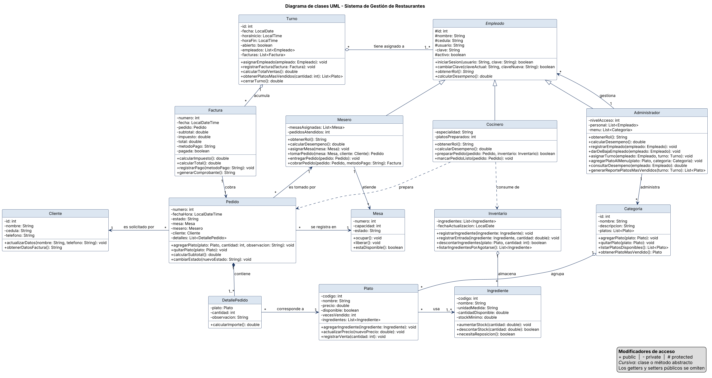

# Sistema de Gestión de Restaurantes

Proyecto semestral de Programación I — Universidad Tecnológica de Panamá.

**Avance #1:** modelo de clases, diagrama de clases UML y estructura del repositorio.

## Integrantes

- Bryan Mark
- Gabriel Ibarra

## Descripción

El Sistema de Gestión de Restaurantes controla las mesas, los pedidos, el menú, la cocina, la facturación y los empleados de un restaurante. Permite registrar los pedidos de cada mesa, llevar el inventario de ingredientes, facturar y cerrar cada turno, y obtener reportes de los platos más vendidos.

## Estructura del repositorio

```text
Gestion-restaurantes/
├── src/
│   ├── main/
│   ├── resources/
│   └── utp/
│       └── Ac/
│           └── Pa/
│               └── sistema/
│                   ├── App.java  (principal)
│                   ├── utils/
│                   │   └── IOUtils.java
│                   └── domain/
│                       ├── Empleado.java
│                       ├── Administrador.java
│                       ├── Mesero.java
│                       ├── Cocinero.java
│                       ├── Cliente.java
│                       ├── Mesa.java
│                       ├── Pedido.java
│                       ├── DetallePedido.java
│                       ├── Plato.java
│                       ├── Categoria.java
│                       ├── Ingrediente.java
│                       ├── Inventario.java
│                       ├── Factura.java
│                       └── Turno.java
├── docs/
│   ├── Avance1-Gestion-restaurantes.docx
│   ├── Avance1-Gestion-restaurantes.pdf
│   └── uml/
│       ├── diagrama-clases.png
│       └── diagrama-clases.puml
└── README.md
```

- `src/utp/Ac/Pa/sistema/App.java`: clase principal, muestra el menú del sistema.
- `src/utp/Ac/Pa/sistema/utils/`: utilidades de entrada y salida por consola.
- `src/utp/Ac/Pa/sistema/domain/`: las 14 clases del modelo.
- `src/resources/`: reservado para archivos de datos del sistema.
- `docs/`: documento del avance y diagrama UML.

## Clases del dominio

| Clase | Responsabilidad |
|---|---|
| `Empleado` | Clase base abstracta con los datos y el acceso al sistema de todo empleado del restaurante. |
| `Administrador` | Empleado que gestiona el menú, el personal y los reportes del restaurante. |
| `Mesero` | Empleado que atiende las mesas, toma los pedidos y los cobra. |
| `Cocinero` | Empleado que prepara los pedidos en la cocina. |
| `Cliente` | Persona que consume en el restaurante y a quien se le emite la factura. |
| `Mesa` | Mesa del restaurante, con su capacidad y su estado (libre u ocupada). |
| `Pedido` | Orden tomada en una mesa, con sus platos y su estado. |
| `DetallePedido` | Línea de un pedido: un plato, su cantidad y una observación. |
| `Plato` | Producto del menú, con su precio y los ingredientes que usa. |
| `Categoria` | Sección del menú que agrupa platos (entradas, platos fuertes, postres, bebidas). |
| `Ingrediente` | Insumo de cocina con su existencia y su stock mínimo. |
| `Inventario` | Registro de los ingredientes disponibles y de sus entradas y salidas. |
| `Factura` | Comprobante de cobro de un pedido, con impuesto, total y método de pago. |
| `Turno` | Jornada de trabajo: empleados asignados, facturas emitidas y cierre de caja. |

## Documentación

- [Documento del Avance #1 (Word)](docs/Avance1-Gestion-restaurantes.docx) · [PDF](docs/Avance1-Gestion-restaurantes.pdf): Tabla 1 (escenarios, clases involucradas, explicación) y Tabla 2 (clase, atributos, métodos).
- [Diagrama de clases UML](docs/uml/diagrama-clases.png); su fuente en PlantUML está en `docs/uml/diagrama-clases.puml`.



## Cómo compilar y ejecutar

Desde la carpeta raíz del repositorio:

```
javac -encoding UTF-8 -d out src/utp/Ac/Pa/sistema/App.java src/utp/Ac/Pa/sistema/utils/*.java src/utp/Ac/Pa/sistema/domain/*.java
java -cp out utp.Ac.Pa.sistema.App
```
